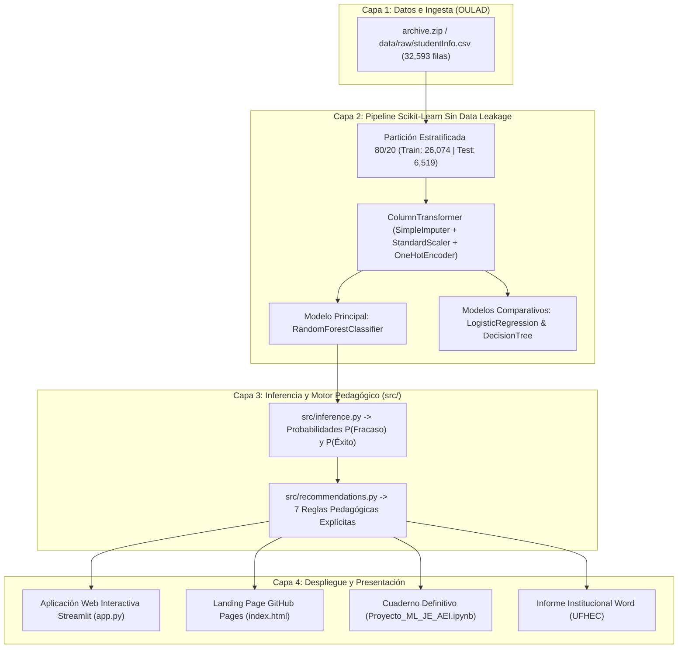

# Proyecto_ML_JE_AEL
# 🎓 Asistente de Inteligencia Artificial para la Planificación Docente


---

## 🏛️ Ficha Académica Institucional

| Atributo | Detalle |
| :--- | :--- |
| **Institución** | Universidad Federico Henríquez y Carvajal (**UFHEC**) |
| **Programa** | Maestría en Inteligencia Artificial Aplicada a la Educación e Investigación |
| **Asignatura** | Aprendizaje Automático (*Machine Learning*) — Código: `IAE-2501` |
| **Docente Titular** | Mtro. Feibert Guzmán |
| **Estudiante / Autora** | **Jhessika Lidabed Espaillat Espaillat** |
| **Dataset de Estudio** | *Open University Learning Analytics Dataset* (**OULAD** — `32,593` registros) |

---

## 📌 1. Resumen del Proyecto

El **Asistente de Inteligencia Artificial para la Planificación Docente** es un prototipo funcional de analítica del aprendizaje (*Learning Analytics*) diseñado para apoyar la toma de decisiones pedagógicas en la educación superior. A partir de los registros académicos y sociodemográficos del conjunto de datos **OULAD (`studentInfo.csv`)**, el sistema entrena y evalúa modelos supervisados de clasificación binaria para estimar tempranamente:

- **`0` — Fracaso académico o retiro (`Fail` / `Withdrawn`):** `17,208` registros (`52.80%`).
- **`1` — Éxito académico (`Pass` / `Distinction`):** `15,385` registros (`47.20%`).

El proyecto integra un pipeline de preprocesamiento **100% libre de fuga de información (*Leak-Free ETL*)**, un modelo principal **Random Forest Classifier** contrastado frente a **Logistic Regression** y **Decision Tree Classifier**, y un **motor determinista de recomendaciones pedagógicas basado en reglas explícitas** que orienta al docente en **7 dimensiones de intervención**.

> **⚖️ Aviso Ético Fundamental:** Todas las predicciones emitidas por el sistema se presentan como **estimaciones estadísticas sujetas a incertidumbre** y tienen un carácter estrictamente orientativo para la planificación docente preventiva. Nunca deben emplearse como diagnósticos definitivos ni para tomar decisiones automáticas sobre los estudiantes.

---

## 🏗️ 2. Arquitectura del Sistema



---

## 📂 3. Estructura del Proyecto

```text
Feibert Proyecto Final/
├── app.py                                           # Aplicación web interactiva en Streamlit (2 pestañas)
├── index.html                                       # Landing page profesional para GitHub Pages (raíz)
├── Proyecto_ML_JE_AEI.ipynb                         # Cuaderno Jupyter definitivo ejecutado (11 etapas)
├── Informe_Academico_Planificacion_Docente_UFHEC.docx # Documento académico institucional UFHEC (APA 7)
├── requirements.txt                                 # Dependencias reproducibles del proyecto
├── README.md                                        # Documentación principal del repositorio
├── archive.zip                                      # Repositorio original de tablas CSV de OULAD
├── css/
│   └── styles.css                                   # Hoja de estilos responsiva de la landing page
├── js/
│   └── main.js                                      # Lógica interactiva del simulador en la landing page
├── src/
│   ├── __init__.py
│   ├── preprocessing.py                             # Ingesta, validación de dominios y ColumnTransformer sin fuga
│   ├── inference.py                                 # Carga del pipeline .joblib y predicción estandarizada
│   └── recommendations.py                           # Motor determinista de reglas pedagógicas (7 dimensiones)
├── models/
│   ├── random_forest_oulad.joblib                   # Pipeline completo entrenado (Preprocesador + Random Forest)
│   └── comparative_metrics.json                     # Métricas reales verificadas (Test, CV 5-Fold y Cohorte 2014J)
├── assets/
│   └── img/                                         # 7 gráficos científicos en alta resolución (EDA y Evaluación)
├── reports/
│   └── Reporte_Perfilado_OULAD.html                 # Informe interactivo generado con YData Profiling
├── notebooks/
│   └── Proyecto_ML_JE_AEI.ipynb                     # Copia organizada del cuaderno definitivo
├── docs/
│   ├── CRISP_ML_Documentation.md                    # Documentación técnica completa bajo estándar CRISP-ML(Q)
│   ├── Informe_Academico_Planificacion_Docente_UFHEC.docx
│   └── ADRs/                                        # Registros de Decisiones de Arquitectura (ADR-001 a ADR-005)
└── video/
    ├── guion_video_espanol.md                       # Guion completo cronometrado del video explicativo en español
    └── presentacion_interactiva_video.html          # Presentación audiovisual interactiva con narración en español
```

---

## ⚙️ 4. Instalación y Configuración del Entorno

1. **Clonar el repositorio o ubicarse en la carpeta raíz del proyecto:**
   ```bash
   git clone https://github.com/JhessikaEspaillat/Proyecto_ML_Planificacion_Docente.git
   cd Proyecto_ML_Planificacion_Docente
   ```
2. **Crear un entorno virtual en Python 3.10+ (recomendado Python 3.12):**
   ```bash
   python -m venv .venv
   # En Windows:
   .venv\Scripts\activate
   # En Linux / macOS:
   source .venv/bin/activate
   ```
3. **Instalar las dependencias desde `requirements.txt`:**
   ```bash
   pip install -r requirements.txt
   ```

---

## 📓 5. Ejecución del Cuaderno Jupyter y Entrenamiento del Modelo

El cuaderno principal [`Proyecto_ML_JE_AEI.ipynb`](file:///Proyecto_ML_JE_AEI.ipynb) desarrolla de forma secuencial las **11 etapas exigidas** (Portada, Ingesta, ETL sin fuga de información, EDA, YData Profiling, Preparación, Entrenamiento, Evaluación, Predicción, Recomendaciones Pedagógicas y Conclusiones).

Para abrirlo e interactuar con sus celdas:
```bash
jupyter notebook Proyecto_ML_JE_AEI.ipynb
```

---

## 🚀 6. Ejecución de la Aplicación Web en Streamlit y Uso del Simulador

Para iniciar localmente la aplicación web interactiva:
```bash
streamlit run app.py
```

### Guía de Uso del Simulador Inteligente:
1. **Pestaña 1 (*Análisis y Evaluación del Modelo*):** Consulte las métricas reales del modelo, la galería de hallazgos del EDA, las matrices de confusión, las curvas ROC, la importancia de variables y descargue o previsualice el informe HTML de **YData Profiling**.
2. **Pestaña 2 (*Simulador Inteligente de Planificación Docente*):**
   - Seleccione uno de los **4 escenarios pedagógicos preconfigurados** o elija *"Personalizado (Ingreso manual)"*.
   - Introduzca las 10 características académicas y sociodemográficas del estudiante (módulo, cohorte, créditos matriculados, intentos previos, escolaridad previa, banda socioeconómica IMD, edad, género, discapacidad y región).
   - Presione **"Ejecutar Predicción y Generar Plan de Intervención Docente"** para obtener la clase predicha (`0` o `1`), las probabilidades de ambas categorías, el nivel de alerta temprana y las **7 recomendaciones pedagógicas activadas por reglas explícitas**.

---

## 📊 7. Resultados Reales Obtenidos

Evaluación verificada sobre el conjunto de prueba independiente (`n = 6,519` estudiantes, partición estratificada `80/20`, `random_state=42`):

| Modelo Supervisado | Accuracy | Balanced Accuracy | Precision (Clase 0) | Recall (Clase 0) | F1-Score (Clase 0) | Precision (Clase 1) | Recall (Clase 1) | F1-Score (Clase 1) | ROC-AUC (Test) | CV 5-Fold ROC-AUC |
| :--- | :---: | :---: | :---: | :---: | :---: | :---: | :---: | :---: | :---: | :---: |
| **Random Forest Classifier (Principal)** | `61.94%` | `62.05%` | `65.12%` | `60.11%` | `0.6252` | `58.92%` | `63.99%` | `0.6135` | **`0.6651`** | `0.6594 ± 0.0046` |
| **Logistic Regression (Comparativo)** | `62.37%` | `62.44%` | `65.31%` | `61.27%` | `0.6323` | `59.48%` | `63.60%` | `0.6147` | `0.6698` | `0.6644 ± 0.0037` |
| **Decision Tree Classifier (Comparativo)** | `60.82%` | `61.12%` | `65.05%` | `55.75%` | `0.6004` | `57.33%` | `66.49%` | `0.6157` | `0.6418` | `0.6386 ± 0.0024` |

- **Validación Temporal Inter-Cohorte (`2013B–2014B` $\rightarrow$ `2014J`, `n = 11,260`):** `Accuracy = 61.41%`, `Balanced Accuracy = 61.33%`, `ROC-AUC = 0.6550`, `F1 Clase 0 = 0.6312`.
- **Top 5 Variables más Influyentes en Random Forest:**
  1. `studied_credits` (`16.78%`)
  2. `highest_education_Lower Than A Level` (`14.01%`)
  3. `num_of_prev_attempts` (`8.03%`)
  4. `code_module_CCC` (`5.07%`)
  5. `age_band_35-55` (`3.66%`)

---

## 🔗 8. Enlaces del Proyecto


### 🌐 Página web del proyecto

[Ver Landing Page en GitHub Pages](https://jhessikaespaillat.github.io/Proyecto_ML_JE_AEL/)

### 🎬 Presentación interactiva con narración en español

[▶️ REPRODUCIR PRESENTACIÓN DEL PROYECTO](https://jhessikaespaillat.github.io/Proyecto_ML_JE_AEL/presentacion_interactiva_video.html)

**Nota:** Al abrir la presentación, selecciona el botón
"Reproducir con Narración en Español" para escuchar la explicación.

### 📂 Repositorio GitHub

[Ver repositorio del proyecto](https://github.com/jhessikaespaillat/Proyecto_ML_JE_AEL)

### 💻 Aplicación de Machine Learning

La aplicación Streamlit está pendiente de confirmar su URL pública.

### 📄 Documentación académica

[Consultar cuaderno Jupyter](Proyecto_ML_JE_AEI.ipynb)

### 📝 Guion del video

[Consultar guion en español](guion_video_espanol.md)


---

## ⚠️ 9. Limitaciones del Sistema

1. **Variables pre-curso únicamente:** Al emplear los atributos disponibles en el momento de la matrícula (`studentInfo.csv`) para ofrecer alertas desde el primer día de clases, el modelo no incorpora aún notas parciales ni clics diarios en el entorno virtual (`studentVle.csv`), lo que acota el `ROC-AUC` alrededor de `0.665–0.670`.
2. **Transferencia contextual:** Los datos reflejan la educación superior a distancia en el Reino Unido; su aplicación en universidades presenciales o semipresenciales de la República Dominicana requiere recalibración con datos institucionales locales.

---

## 📚 10. Referencias Bibliográficas (APA 7)

- Breiman, L. (2001). Random forests. *Machine Learning*, 45(1), 5–32. https://doi.org/10.1023/A:1010933404324
- CAST. (2018). *Universal Design for Learning Guidelines version 2.2*. Center for Applied Special Technology. http://udlguidelines.cast.org
- Kuzilek, J., Hlosta, M., & Zdrahal, Z. (2017). Open University Learning Analytics dataset. *Scientific Data*, 4(1), 170171. https://doi.org/10.1038/sdata.2017.171
- Pedregosa, F., Varoquaux, G., Gramfort, A., Michel, V., Thirion, B., Grisel, O., Blondel, M., Prettenhofer, P., Weiss, R., Dubourg, V., Vanderplas, J., Passos, A., Cournapeau, D., Brucher, M., Perrot, M., & Duchesnay, E. (2011). Scikit-learn: Machine learning in Python. *Journal of Machine Learning Research*, 12, 2825–2830.
- Romero, C., & Ventura, S. (2020). Educational data mining and learning analytics: An updated survey. *WIREs Data Mining and Knowledge Discovery*, 10(3), e1355. https://doi.org/10.1002/widm.1355
- Studer, S., Bui, T. B., Drescher, C., Hanuschkin, A., Winkler, L., Peters, S., & Müller, K. R. (2021). Towards CRISP-ML(Q): A machine learning process model with quality assurance methodology. *Machine Learning and Knowledge Extraction*, 3(2), 392–413. https://doi.org/10.3390/make3020020

